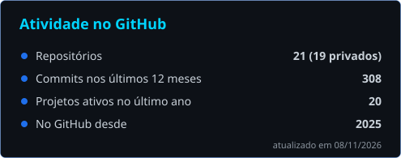
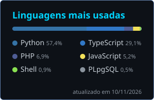
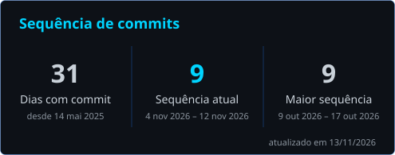

---

<table align="center">
<tr>
<td align="center" width="33%">🔎 <b>Inteligência & OSINT</b></td>
<td align="center" width="33%">🛡️ <b>Segurança da informação</b></td>
<td align="center" width="33%">🚨 <b>Segurança pública</b></td>
</tr>
<tr>
<td align="center">🛰️ <b>IoT & telemetria</b></td>
<td align="center">📱 <b>Web & mobile</b></td>
<td align="center">🤖 <b>Automação & IA</b></td>
</tr>
</table>

---

---

